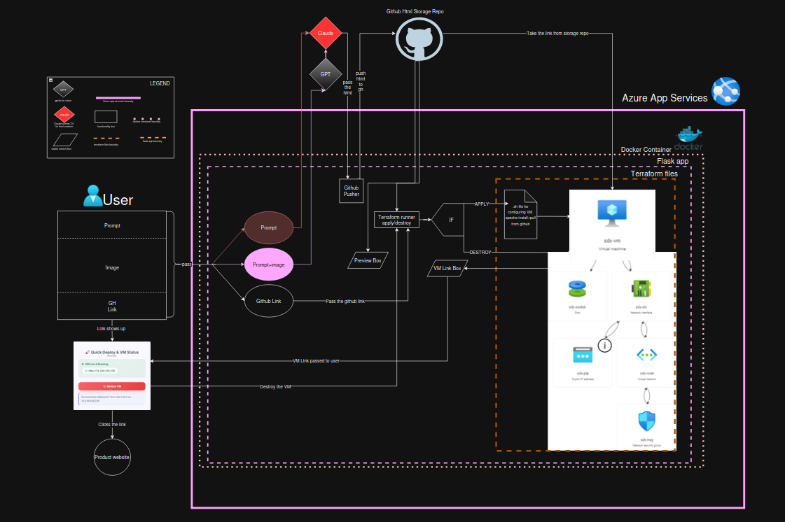

# Flask + Terraform AI Website Deployer

> Internship project from 2025 (SabancıDx, cloud engineering). It is no longer maintained and is kept here as a reference.

A self-service platform that generates a website with AI and deploys it to a fresh Azure VM in one click. When the user is done, they can destroy the whole thing just as easily.



## How it works

1. **Generate.** The user picks one of three inputs:
   - a text prompt, which Claude turns into HTML
   - a prompt plus an image, which GPT Vision describes and Claude turns into HTML
   - an existing GitHub link
2. **Preview.** The generated site is shown in desktop, tablet and mobile previews.
3. **Store.** The Flask app pushes the HTML to [html-pages-storage](https://github.com/barisMarathon/html-pages-storage).
4. **Deploy.** Clicking **Deploy AI Site** runs `terraform apply`. This creates a resource group, VNet, subnet, NSG, public IP, NIC and Linux VM. A startup script installs Apache, pulls the site from GitHub and serves it.
5. **Use.** The VM's public IP comes back from the Terraform outputs and is shown as the live link.
6. **Destroy.** Clicking **Destroy VM** runs `terraform destroy` and removes the resource group.

## Stack

| Layer | Tech |
|---|---|
| App | Python / Flask |
| AI | Anthropic Claude (HTML generation), OpenAI GPT Vision (image input) |
| IaC | Terraform (`azurerm`) |
| Runtime | Docker container on Azure App Service (Flask and Terraform run in the same container) |
| Target | Azure Linux VM + Apache, set up by a bash script |
| Storage | GitHub repo for the generated HTML |

## Project layout

```
app.py              Flask routes: generate, deploy, destroy
ai.py               Claude prompt -> HTML
gpt_vision.py       Image -> description
github_helper.py    Pushes generated HTML to the storage repo
terraform/          VM infrastructure (main.tf, variables.tf, outputs.tf, install script)
Dockerfile          Flask and Terraform in one image
```

## Running locally

```bash
cp terraform/terraform.tfvars.example terraform/terraform.tfvars   # fill in your Azure values
export ANTHROPIC_API_KEY=... OPENAI_API_KEY=... GITHUB_TOKEN=...
export ARM_CLIENT_ID=... ARM_CLIENT_SECRET=... ARM_SUBSCRIPTION_ID=... ARM_TENANT_ID=...
docker build -t ai-site-deployer . && docker run -p 80:80 --env-file .env ai-site-deployer
```

Secrets are read from environment variables (App Service settings in production) and are never committed.

## Known limitations / what I'd do differently

- **Terraform state is local to the container.** If the container restarts, the state is lost and `destroy` can no longer find the resources. Next time I'd use a remote backend (Azure Storage) with state locking.
- **One shared state.** Concurrent deploys from several users would conflict. A separate workspace or state key per deployment would fix that.
- **Running Terraform synchronously inside the web request** blocks the UI. A job queue or a pipeline (GitHub Actions / Container Apps jobs) would scale better.
- **A full VM per static site** is expensive. Blob Storage static hosting or a shared container would be far cheaper.

## Links

- Generated pages storage: https://github.com/barisMarathon/html-pages-storage
- Demo video (Google Drive): https://drive.google.com/drive/u/0/folders/17Da9h1GquZIYc5FNkXXOp7G4H1tMI-W0
- Architecture diagram (draw.io, editable): [diagram 1](https://viewer.diagrams.net/?tags=%7B%7D&lightbox=1&highlight=0000ff&edit=_blank&layers=1&nav=1&title=flask-terraform-2.drawio&dark=auto#Uhttps%3A%2F%2Fdrive.google.com%2Fuc%3Fid%3D1OijOf67aDZlETFq5YyN8Gm1oKuuAhyJs%26export%3Ddownload#%7B%22pageId%22%3A%22-jeOLZyow7tsawBEThXN%22%7D) · [diagram 2](https://viewer.diagrams.net/?tags=%7B%7D&lightbox=1&highlight=0000ff&edit=_blank&layers=1&nav=1&title=flask-terraform-DSD.drawio&dark=auto#Uhttps%3A%2F%2Fdrive.google.com%2Fuc%3Fid%3D1ztAJDR5qAF_eMeMvzznUh19GX44ez9jg%26export%3Ddownload)
- The live App Service (`flask-terraform-webapp-2025.azurewebsites.net`) has been shut down.
